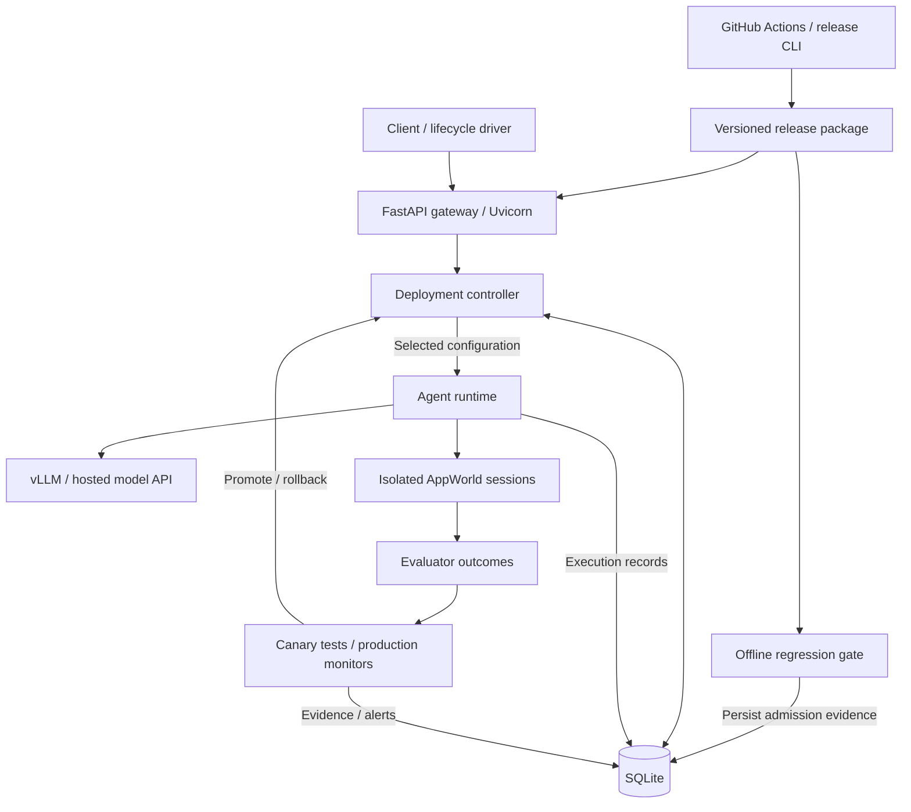

# Reliable CI/CD Infrastructure for Stateful LLM Agents

A Python/FastAPI deployment system for tool-using agents, integrating versioned execution, behavioral regression gates, canary routing, durable deployment state, production monitoring, and automated rollback.

Changes to an agent's model, prompt, tool interface, or runtime can alter application behavior while its HTTP API remains unchanged. `llm-behavior-ci` connects behavioral evaluation to release control: evaluate a candidate, verify its admission evidence, compare it with production in isolated application environments, and restore the previous configuration when the configured rollback policy fires.

## Engineering highlights

- **Built a connected release lifecycle:** offline regression testing, canary execution, promotion, production monitoring, and recovery share configuration identities and persisted evidence.
- **Implemented a stateful backend:** a FastAPI gateway routes by deployment state, bounds in-flight work, and records agent execution and evaluator outcomes in SQLite.
- **Engineered recovery semantics:** idempotent rollback, incident deduplication, request-level configuration identity, and startup reconciliation keep routing consistent across deployment transitions.
- **Designed reproducible releases:** content-addressed evidence, archived code, SHA-256 integrity checks, and cross-commit compatibility verification bind each release to its inputs.
- **Integrated automated verification:** GitHub Actions exercises CPU test suites and four synthetic lifecycle outcomes, including rollback after promotion.

## System architecture

The system has two cooperating paths: release orchestration prepares and evaluates configurations; the serving path executes requests and feeds deployment decisions back into routing.



AppWorld supplies application state, tool APIs, and objective task evaluation. The repository implements the runtime adapters, execution lifecycle, routing, evidence contracts, persistence, and deployment policy around those interfaces.

## Core engineering components

### Backend service and agent execution

The [gateway](src/llm_behavior_ci/service.py) registers production and candidate configurations and selects runtimes by configuration hash. Deterministic canary assignment maps a request key to a configurable traffic fraction. Each selected canary request executes the candidate and a production reference in separate AppWorld worlds initialized from the same task state; the candidate is the served arm and production supplies the shadow comparison.

| Endpoint | Responsibility |
| --- | --- |
| `POST /episodes` | Execute a plan or tool-using episode under the selected configuration; return an execution receipt. |
| `POST /candidates` | Admit the registered candidate using a persisted validation artifact. |
| `GET /deployment` | Report serving identity, deployment state, and rollback details. |
| `POST /deployment/rollback` | Close an active canary or restore the previous production after promotion. |

A bounded semaphore enforces in-flight admission, while a deployment lock protects routing and state transitions. Each production request captures its configuration and monitoring period together. If a promotion or rollback occurs before it finishes, its original identity stays in the receipt and its completion is marked `superseded` for monitoring.

The [runtime factory](src/llm_behavior_ci/runtime/factory.py) builds adapters for self-hosted vLLM, Anthropic, and Z.AI's OpenAI-compatible API. The agent layer implements smolagents model and action-executor interfaces; tool actions run through AppWorld. A separate batch-capture path uses spawned worker processes so each worker owns its runtime, worlds, and database connections.

### Deployment controller and monitoring

The [canary controller](src/llm_behavior_ci/lifecycle/canary.py) manages admission, active evaluation, promotion, and rollback. It tracks outstanding work, candidate exposure, and paired evaluator outcomes. Promotion creates a monitoring period tied to the promoted configuration and the previous production reference.

The [monitoring layer](src/llm_behavior_ci/lifecycle/monitoring.py) consumes task success, requirement completion, tool errors, trajectory length, and configured distributional signals. Detection and deployment policy are separate: `record_only` persists alerts; `rollback_on_alert` restores the previous production on an eligible aggregate task-success alert for the promoted configuration and its monitoring period. Manual rollback uses the same recovery transition.

### Persistence and restart recovery

[SQLite storage](src/llm_behavior_ci/storage.py) records episodes, model and tool steps, paired results, validation artifacts, deployment decisions, monitor metadata, alerts, and model-call reservations. The episode store uses WAL mode and a single owning writer; the budget ledger uses separate connections and SQLite transactions to coordinate reservations across threads and processes.

At startup, the service validates stored decisions against its registered configurations and reconstructs serving state. Completed promotions and rollbacks survive restart. An unfinished canary is closed with a persisted rollback. Under the automatic rollback policy, startup also reconciles an eligible alert persisted before an interruption prevented its rollback record from being written.

Repeated alerts and rollback requests are idempotent. If a post-promotion rollback record cannot be written, the service restores the previous production, exposes the pending persistence state, and retries the write on the next rollback request.

### Release integrity and resource control

The [release builder](src/llm_behavior_ci/lifecycle/release.py) provisions each release in a staging directory and renames it into place after construction. Its manifest pins configuration files, settings, task-set identities, budgets, and an archived code tree. Verification runs before activation, during reuse, and at service startup; the code digest covers file contents, executable bits, paths, and symlink targets without requiring a `.git` directory.

Consecutive releases preserve the deployed configuration's original commit and hash. Carrying it forward requires verified release lineage, an ancestor relationship, and either an identical execution fingerprint or a committed compatibility declaration. That fingerprint covers the package, serving and release scripts, task metadata, and dependency pins.

[Model-call budgets](src/llm_behavior_ci/runtime/budget.py) reserve a unit in SQLite before each model generation or teacher-forced scoring operation. The reservation commits under `BEGIN IMMEDIATE` before execution. Failed and interrupted operations retain their charge, and restarts reuse the ledger. Gate and service budgets have separate scopes; episode-count checks bound the planned workload before execution.

## Three-tier release lifecycle

| Stage | Evaluation | Deployment effect |
| --- | --- | --- |
| **Tier 1: offline gate** | Compare candidate and reference plans on fixed tasks without executing tools. Use paired plan-quality bootstrap and MMD; self-hosted configurations can also supply teacher-forced plan KL. | Persist a content-addressed PASS or BLOCK artifact. Admission verifies its provenance and configuration binding. |
| **Tier 2: canary** | Execute paired candidate/reference episodes in isolated worlds and update a stopping rule from binary evaluator success. | Roll back on the configured harm boundary, or promote under the explicit `horizon_reached_without_harm` exposure policy. |
| **Tier 3: production monitoring** | Monitor the promoted configuration against frozen baselines associated with previous production. | Persist alerts and apply the selected post-promotion rollback policy. |

The [connected lifecycle command](scripts/demo/run_three_tier_dev.py) drives these stages through the service API and checks the configuration actually serving after each transition. A BLOCK stops before admission. If the canary arrival budget ends without a decision, the driver closes the candidate and verifies fallback routing.

[GitHub Actions](.github/workflows/release-lifecycle.yml) connects CPU verification, the synthetic scenario matrix, release provisioning, service activation, and the live lifecycle command. Provisioning and live execution are explicitly enabled stages. The activation script verifies the package before switching the active release and restores the previous service if registration fails. [Release procedures](docs/RELEASE_PIPELINE.md) cover deployment configuration and operation.

## Reliability and design decisions

| Engineering problem | Design choice and rationale |
| --- | --- |
| Agent actions mutate application state | Give each comparison arm a fresh AppWorld session, preserving comparable initial conditions and independent side effects. |
| Full execution is expensive for every change | Use plan-only regression testing as the first admission filter, then evaluate actual task execution during the canary. |
| A deployment changes while requests are running | Capture configuration and monitoring-period identity together; persist late completions without mixing them into a new period. |
| The baseline can drift with a degraded release | Freeze the previous production reference for the promoted configuration's monitoring period. |
| Recovery needs durable, inspectable state | Use SQLite transactions and explicit decision records for the single-host service, with startup reconciliation against registered configuration hashes. |
| A retry or restart can reset an in-memory budget | Persist reservations before model operations and retain charges after failure or interruption. |
| Code and evidence can diverge across releases | Verify content hashes, archived code, release lineage, and execution compatibility before carrying production forward. |

## Implementation and validation

The evidence below distinguishes real-model integration from synthetic lifecycle verification. CI references are pinned to the reviewed implementation at [`6d9a65d`](https://github.com/sathviknookala/llm-behavior-ci/commit/6d9a65de0021e285314305ef696d27bca766131f).

| Evidence | Verified result |
| --- | --- |
| **Real-model execution** | The committed [hosted-agent pilot](results/spotify_capability_20_sonnet_5_5.json) completed 20 AppWorld episodes with 14 evaluator successes, 253 executed tool actions, and zero runtime failures. |
| **Synthetic release lifecycle** | Four scenarios verify a blocked candidate, successful promotion, canary rollback, and post-promotion rollback, including serving identity and persisted evidence. |
| **Recovery integration tests** | [Tests](tests/integration/test_production_rollback.py) cover duplicate alerts, in-flight completion during rollback, restart recovery, interrupted alert-to-rollback persistence, and invalid lineage. |
| **Concurrent budget enforcement** | [Tests](tests/unit/test_model_call_budget.py) cover 16 threads and four processes racing for remaining reservations, provider failure, interrupted execution, process death, and restart accounting. |
| **Release integrity tests** | [Tests](tests/integration/test_release_pipeline.py) cover cross-commit continuity, incompatible runtime changes, shallow history, stale evidence, and archived-code tampering. |
| **GitHub CI** | [Pull-request verification](https://github.com/sathviknookala/llm-behavior-ci/actions/runs/38097191572), [main-branch verification](https://github.com/sathviknookala/llm-behavior-ci/actions/runs/38097305067), and the [release workflow's CPU and four synthetic jobs](https://github.com/sathviknookala/llm-behavior-ci/actions/runs/38097305070) passed. |

Synthetic runs use injected runtimes and explicitly labeled fixture evidence to exercise the real lifecycle and service code. Release admission requires evidence from a gate run. The live pilot establishes model/tool/evaluator integration; the synthetic scenarios establish deployment and recovery behavior.

## Technology and repository structure

**Backend:** Python 3.12, FastAPI, Uvicorn, SQLite. **Agent execution:** AppWorld, smolagents interfaces, vLLM/PyTorch and hosted model APIs. **Evaluation:** NumPy, SciPy, River, and repository implementations of bootstrap, divergence, sequential testing, and change detection. **Delivery:** GitHub Actions, Git, Bash, systemd, and SHA-256 release manifests.

| Path | Responsibility |
| --- | --- |
| [`src/llm_behavior_ci/service.py`](src/llm_behavior_ci/service.py) | HTTP API, routing, admission, and deployment recovery. |
| [`src/llm_behavior_ci/lifecycle/`](src/llm_behavior_ci/lifecycle/) | Gate, canary, monitors, connected orchestration, and release management. |
| [`src/llm_behavior_ci/runtime/`](src/llm_behavior_ci/runtime/) | Model adapters, AppWorld sessions, episode execution, provenance, and budgets. |
| [`src/llm_behavior_ci/storage.py`](src/llm_behavior_ci/storage.py) | Durable execution, evidence, and decision records. |
| [`src/llm_behavior_ci/stats/`](src/llm_behavior_ci/stats/) | Statistical tests and streaming detectors. |
| [`configs/`](configs/) | Versioned model, agent, task-selection, fault, and release inputs. |
| [`scripts/`](scripts/README.md) | Service entry points, release tools, demos, and evaluation commands. |
| [`tests/`](tests/) | Unit, CLI/CI, integration, and statistical-validity suites. |

## Getting started

Run the CPU tests and synthetic lifecycle on Python 3.12. These paths use injected model and world implementations and require no GPU, provider credentials, or AppWorld dataset.

```bash
git clone https://github.com/sathviknookala/llm-behavior-ci.git
cd llm-behavior-ci
python3.12 -m venv .venv
source .venv/bin/activate
python -m pip install -r environments/test-requirements.txt
export PYTHONPATH=src
```

Run the four suites used by CI:

```bash
python -m unittest discover -s tests/unit -p 'test_*.py'
python -m unittest discover -s tests/ci -p 'test_*.py'
python -m unittest discover -s tests/integration -p 'test_*.py'
python -m unittest discover -s tests/validity -p 'test_*.py'
```

Exercise each release outcome:

```bash
python scripts/demo/run_three_tier_dev.py synthetic --scenario blocked
python scripts/demo/run_three_tier_dev.py synthetic --scenario healthy
python scripts/demo/run_three_tier_dev.py synthetic --scenario regression
python scripts/demo/run_three_tier_dev.py synthetic --scenario production_regression
```

Each command emits JSON and exits `0` when its expected scenario is verified. Check `verified: true` and the `checks` fields for deployment state, serving configuration, stored decisions, gate evidence, and persisted episodes.

| Scenario | Expected `status` |
| --- | --- |
| `blocked` | `blocked` |
| `healthy` | `promoted` |
| `regression` | `rolled_back` |
| `production_regression` | `production_rolled_back` |

For model-backed execution, follow the [hosted lifecycle runbook](docs/HOSTED_LIFECYCLE.md). For persistent service activation and consecutive releases, use the [release pipeline guide](docs/RELEASE_PIPELINE.md). [Design decisions](docs/DECISIONS.md), the [evaluation protocol](docs/EVAL_PROTOCOL.md), and the [data contract](docs/DATA.md) provide the deeper implementation and evaluation context.
